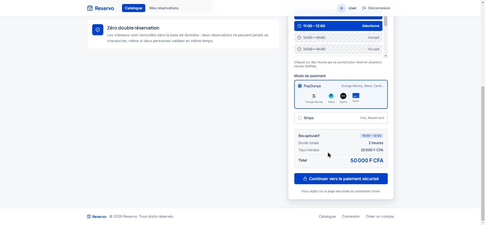
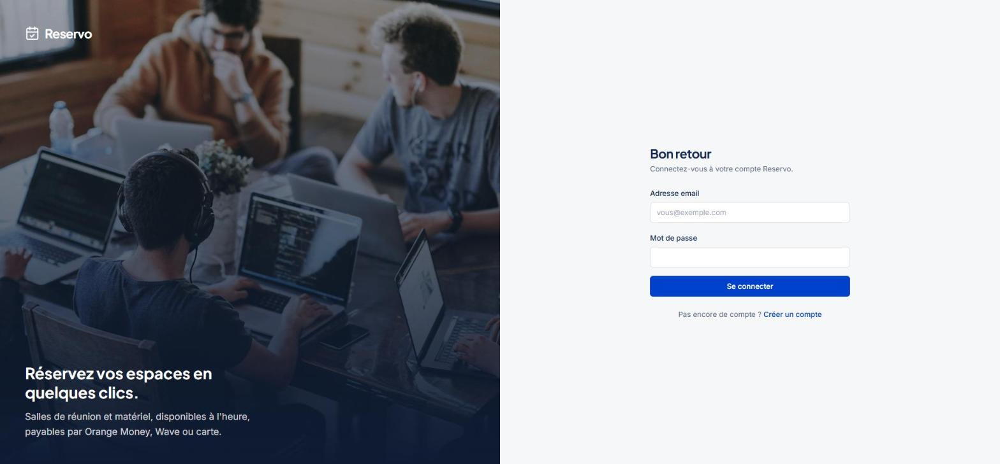
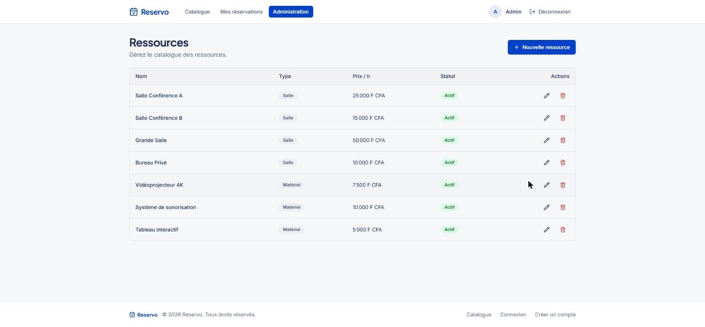
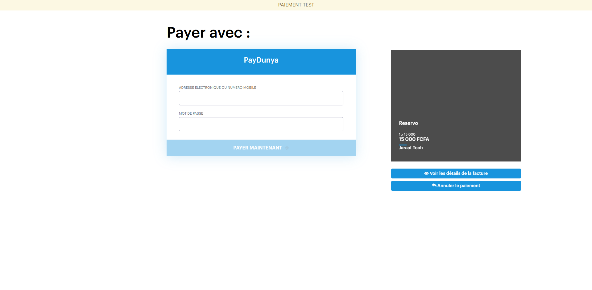

# Reservo

A resource reservation platform for rooms and equipment, priced in **F CFA**.
Users browse a catalogue, pick an hourly slot, and pay online with **PayDunya** (Orange Money, Wave, Djamo, card) or **Stripe**.
Admins manage the catalogue.

[](https://github.com/sarrmouhamed29/reservo/actions/workflows/ci.yml)


## Screenshots

| | |
|---|---|
|  **Catalogue** — search, availability window, type and capacity filters, sort, pagination |  **Slot picker** — taken hours come from the database and cannot be selected |
|  **Payment** — recap, then PayDunya or Stripe checkout |  **My bookings** — status, tabs, sort, pay or cancel |
|  **Sign in** |  **Administration** — catalogue management |
|  **PayDunya checkout** — sandbox page the user is redirected to | |

## Features

- **Catalogue** — filter by name, type, capacity and availability window; sort by price or capacity; paginated
- **Hourly slot picker** — week strip and one-hour slots driven by real availability (`GET /resources/{id}/availability`)
- **No double booking** — enforced by a PostgreSQL exclusion constraint, not by application code
- **PayDunya (primary) and Stripe (optional)** — a booking becomes `paid` only when the provider's webhook is verified
- **F CFA** — amounts are whole francs (`hourly_price`, `total_price`); XOF has no minor unit
- **Roles** — users book, admins manage the catalogue
- **SPA** — React 18 with cookie-based Sanctum authentication

## Stack

| Layer | Technologies |
|---|---|
| Backend | PHP 8.3, Laravel 11, Laravel Sanctum |
| Frontend | React 18, React Router 6, Tailwind CSS, shadcn/ui, Vite |
| Database | PostgreSQL 16 (`btree_gist` for the exclusion constraint) |
| Payments | PayDunya (REST, sandbox/live), Stripe Checkout (test mode) |
| Quality | Pest, Vitest + MSW, Pint, Larastan (level 6), ESLint, Prettier |
| Dev infra | Docker Compose, GitHub Actions CI |

## Architecture

```
Browser (React SPA)
   │  Axios + Sanctum cookie, /api/v1
   ▼
nginx ── /api, /sanctum ──► PHP-FPM (Laravel 11) ──► PostgreSQL 16
   │                              ▲
   └─ /* → React build            └── POST /paydunya/webhook, /stripe/webhook
```

Laravel layering: `Controller → FormRequest → Action → API Resource`. Policies authorize every endpoint.

### Booking conflict prevention

Overlapping bookings are impossible at the database level:

```sql
EXCLUDE USING gist (
  resource_id WITH =,
  tstzrange(starts_at, ends_at, '[)') WITH &&
) WHERE (status != 'cancelled')
```

The violation (`SQLSTATE 23P01`) becomes a `BookingConflictException` and an HTTP 409.

### Payment flow

```
User picks a slot ──► POST /bookings            (status: pending)
                 └──► POST /bookings/{id}/paydunya-checkout   (or /checkout for Stripe)
                          │ creates the invoice, stores its token
                          ▼
                 redirect to the provider's page, user pays
                          │
Provider ──► POST /paydunya/webhook  (or /stripe/webhook)
Return page ──► POST /bookings/{id}/paydunya-sync   (PayDunya only)
                          │ PayDunya: the invoice is re-fetched from PayDunya's API
                          │ Stripe:   the signature is verified
                          ▼
                 booking status = paid   (idempotent)
```

The page the user returns to never marks anything as paid: the success page only polls `GET /bookings?paydunya_invoice_token=…`.

## Quick start

### Prerequisites

- Docker Desktop with Compose v2
- A [PayDunya](https://paydunya.com) test application (Payin enabled) and, optionally, a Stripe test account

### 1. Configure

All configuration lives in **one** file at the repository root, read by Docker Compose and injected into the Laravel container.

```bash
cp .env.example .env
```

```env
PAYDUNYA_MASTER_KEY=...
PAYDUNYA_PRIVATE_KEY=...
PAYDUNYA_PUBLIC_KEY=...
PAYDUNYA_TOKEN=...
PAYDUNYA_MODE=test            # test | live

STRIPE_KEY=pk_test_...        # optional
STRIPE_SECRET=sk_test_...
STRIPE_WEBHOOK_SECRET=whsec_...
```

`APP_KEY` must be set (`docker compose run --rm app php artisan key:generate --show`).

### 2. Start

```bash
docker compose up -d --build
docker compose exec app php artisan migrate --seed
```

`up` also runs a one-shot `frontend-build` service that builds the React app into the volume nginx serves, so there is nothing to build by hand. Open [http://localhost](http://localhost).

For hot reload while developing, add the `dev` profile and use [http://localhost:5173](http://localhost:5173):

```bash
docker compose --profile dev up -d
```

After changing the frontend, rebuild what port 80 serves with `docker compose run --rm frontend-build`.

### 3. Sign in

The seed creates:

| Role | Email | Password |
|---|---|---|
| Admin | admin@reservo.test | admin |
| User | user@reservo.test | user |

plus 7 resources (4 rooms, 3 equipment items) priced from 5 000 to 50 000 F CFA/h, and demo bookings for the user in every status, with a few hours already taken on the next day so the slot picker shows busy slots.

### 4. Try a payment

In PayDunya's dashboard, create a fictitious customer (*Clients fictifs*) for your test application. Book a slot, choose PayDunya and complete the checkout with that customer. PayDunya's IPN cannot reach `localhost`, so the return page also settles the booking: it calls `POST /bookings/{id}/paydunya-sync`, and the server asks PayDunya whether the invoice is completed (the redirect itself proves nothing). A pending booking with a started payment also has a *Vérifier mon paiement* button. In production, point the IPN to `/paydunya/webhook`.

For Stripe webhooks: `stripe listen --forward-to localhost/stripe/webhook`.

## Development

```bash
# Backend
docker compose exec app php artisan test
docker compose exec app ./vendor/bin/pint
docker compose exec app ./vendor/bin/phpstan analyse --memory-limit=512M

# Frontend (the node container has the dependencies)
docker compose exec node npm test -- --run
docker compose exec node npm run lint
docker compose exec node npm run format:check
```

Tests use their own `reservo_test` database (forced in `phpunit.xml`), never the development one.

## API reference

Prefix `/api/v1`. Authentication uses Sanctum cookie sessions: call `GET /sanctum/csrf-cookie` before any state-changing request.

| Method | Endpoint | Auth | Description |
|---|---|---|---|
| GET | `/resources` | — | List. Query: `name`, `type`, `capacity_min`, `capacity_max`, `sort` (`price_asc`, `price_desc`, `capacity_desc`), `available_from` + `available_to`, `page`, `per_page` (max 24) |
| GET | `/resources/{id}` | — | Detail |
| GET | `/resources/{id}/availability?date=YYYY-MM-DD` | — | Busy intervals of the day (no booker information) |
| POST / PUT / DELETE | `/resources`, `/resources/{id}` | admin | Manage the catalogue |
| POST | `/auth/register`, `/auth/login` | guest | Register, sign in |
| POST | `/auth/logout` | user | Sign out |
| GET | `/user` | user | Current user |
| GET | `/bookings` | user | My bookings. Optional filters: `paydunya_invoice_token`, `stripe_session_id` |
| POST | `/bookings` | user | Create (409 if the slot is taken) |
| GET | `/bookings/{id}` | user | Detail |
| DELETE | `/bookings/{id}` | user | Cancel |
| POST | `/bookings/{id}/paydunya-checkout` | user | Start a PayDunya checkout |
| POST | `/bookings/{id}/paydunya-sync` | user | Ask PayDunya for the invoice status and settle the booking |
| POST | `/bookings/{id}/checkout` | user | Start a Stripe checkout |
| POST | `/paydunya/webhook`, `/stripe/webhook` | — | Provider webhooks (no CSRF) |

```json
{ "resource_id": 1, "starts_at": "2026-11-15T09:00:00Z", "ends_at": "2026-11-15T11:00:00Z" }
```

Booking times are read as UTC. The price is `ceil(hours × hourly_price)` in whole F CFA.

## Project structure

```
reservo/
├── .github/workflows/ci.yml
├── backend/                 # Laravel 11
│   ├── app/Actions/         # CreateBooking, CreatePayDunyaCheckout, HandlePayDunyaIpn, …
│   ├── app/Http/            # Controllers, Requests, Resources
│   ├── app/Policies/
│   ├── database/            # migrations, factories, seeders (incl. DemoBookingSeeder)
│   └── tests/Feature/       # auth, resources, bookings, PayDunya, Stripe
├── frontend/                # React 18 + Vite
│   ├── public/payments/     # payment partner logos
│   └── src/                 # api, components, contexts, pages, router
├── nginx/default.conf
├── docs/screenshots/
├── docker-compose.yml
└── .env.example
```

## CI

GitHub Actions on every push and pull request to `main` and `develop`:

- **backend** — Pint, Larastan, Pest (coverage ≥ 80 %)
- **frontend** — ESLint, Prettier check, Vitest coverage, production build

## License

MIT — see [LICENSE](LICENSE).
